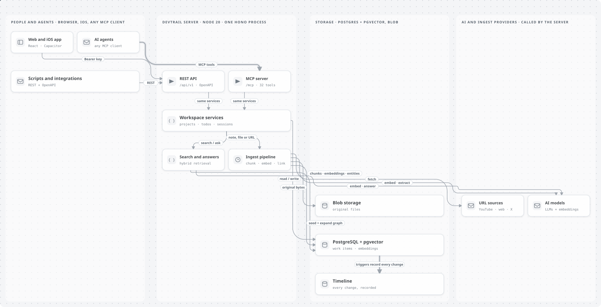

# DevTrail — Architecture

Reference for how DevTrail is built, for people and AI agents who want a complete, factual picture of the code.

> **Reality check first.** Architecture changes happen between sessions. Cheap checks before trusting this doc:
> - `git log --oneline -20` — recent changes
> - `find src -type f -name '*.ts' | sort` — what files actually exist
> - `ls migrations/` — current schema
> - `cat package.json` — current deps
> - `curl <app-url>/health` — what is deployed
>
> If a memory or doc references a file/function/entity that no longer exists in the repo, **the code wins**. Update or remove the stale doc.

> **Path convention.** Backend paths such as `src/services/foo.ts` are relative to `backend/` (so `backend/src/services/foo.ts` on disk); `migrations/`, `infra/` and `shared/` are at the repository root.

---

## 1. Purpose

DevTrail is a **shared workspace where people and AI agents track work**. The owner organizes knowledge into **projects**; each project holds documents (uploaded files and saved URLs), notes (written text), todos (with subtasks and comments) and **sessions**, the workspaces an agent or person creates or resumes by a stable key and hands off with a summary, decisions and next steps. Database triggers record every change on a durable **project and session timeline**. Hybrid semantic + entity-graph search spans everything, and a retrieval-augmented Q&A surface answers with citations.

There is **no multi-tenancy**: one owner per deployment.

Three client surfaces, all served by one Hono process on Node 20:

| Surface | Path | Used by |
|---------|------|---------|
| REST API | `/api/v1/*` | Web app, scripts, integrations |
| MCP server | `/mcp` | Claude Code, Codex, Claude Desktop, any MCP client |
| Web app | `/` (static) | The owner's browser, and the iOS shell |

---

## 2. System Overview



The diagram source is [images/architecture.graph.json](images/architecture.graph.json); the two flow diagrams ([handoff](images/handoff-flow-light.svg), [ask](images/ask-flow-light.svg)) show a session handoff and a cited answer step by step.

| Path | Purpose | Auth |
|---|---|---|
| `/` | Static web app from `frontend/dist` | sign-in screen (API key) or Easy Auth |
| `/health` | `{"ok":true,...}` | public |
| `/api/v1/*` | REST adapter (`src/app.ts`, `src/workspace-routes.ts`) | Bearer |
| `/api/v1/openapi.json`, `/api/v1/docs` | OpenAPI 3.1 spec and Swagger UI | public |
| `/mcp` | MCP adapter (fresh server per request) | Bearer (`?key=` only with `MCP_ALLOW_URL_KEY=true`) |
| `/api/auth/token` | Easy Auth cookie → API key exchange | only with `AUTH_MODE=easyauth` |

Migrations apply automatically on startup.

### Architecture pattern: thin adapters, fat services

All business logic lives in `src/services/`. The two API adapters — REST in `src/app.ts`, MCP in `src/mcp/server.ts` — are thin: parse input, call a service function, format response. Service functions accept `ServiceDeps` (the dependency injection container with db, providers, blob, config) as their first argument.

Direction of dependencies: **adapters → services → db/providers**. Adapters never call other adapters. Services never import adapter code. This makes service-layer functions trivial to unit-test (pass mocks via `ServiceDeps`) and lets new adapter surfaces drop in without touching business logic.

---

## 3. Stack

| Layer | Tech |
|-------|------|
| API | Hono on Node 20, served by `@hono/node-server` |
| Web UI | Vite + React (hand-rolled CSS in `frontend/src/styles.css`), built into `frontend/dist`, served statically by Hono |
| MCP | `@modelcontextprotocol/sdk` over `WebStandardStreamableHTTPServerTransport` (stateless, fresh server + transport per request) |
| Database | PostgreSQL Flexible Server (B1ms) + pgvector (3072-dim, sequential scan — no HNSW) |
| Blob storage | Azure Blob Storage (`Allow Blob Public Access = false`; SAS read URLs at API response time) |
| Container | Docker on Azure Container Apps |
| CI/CD | GitHub Actions (OIDC) |
| Migrations | Auto-applied on container startup via `runMigrations()` in `src/server.ts` |

### AI models

| Role | Provider | Model ID | Dependency-injection key |
|------|----------|----------|--------------------------|
| Embeddings | Gemini | `gemini-embedding-2-preview` (3072d, multimodal) | `embeddingProvider` |
| Metadata + entity extraction (text, image OCR, pdf-extracted text) | Anthropic | `claude-haiku-4-5-20251001` | `metadataLLM` |
| Metadata for audio/video (Haiku doesn't accept audio input) | Gemini | `gemini-3-flash-preview` | `mediaMetadataLLM` |
| Query depth classifier + query-entity extractor | Anthropic | `claude-haiku-4-5-20251001` | `queryDepthLLM` |
| RAG fast path | Azure Foundry chat completions | `gpt-5-4` (default; `AZURE_RAG_DEPLOYMENT`) | `ragFastLLM` |
| RAG thorough path | Azure Foundry Responses API | `gpt-5-4-pro` (default; `AZURE_DEEP_RAG_DEPLOYMENT`) | `ragDeepLLM` |

Wired in `src/server.ts`. The `ServiceDeps` interface is in `src/services/index.ts`.

---

## 4. Data Architecture

11 tables: 5 core, 2 for the entity graph and 4 for sessions and timelines (`project_sessions`, `project_timeline_events`, `session_file_cleanup`, `project_memory`). The diagram shows the core and graph tables. No ORM — raw SQL via the `pg` driver, with `db/*.ts` modules for the core and graph tables; the session and timeline SQL lives in `db/timeline.ts` and the session and project services.

```
projects
  +------------------------+
  | id, name, description, |
  | status, archived,      |
  | created/updated_at     |
  +------------------------+
        ^                ^
        | uuid[]         | uuid (FK, ON DELETE SET NULL)
        |                |
content_items          todos
  +-----------+        +------------------+
  | id        |        | id               |
  | type:     |        | content          |
  |  document |        | status           |
  |  /note    |        | priority         |
  | content   |        | due_date         |
  | source_url|        | parent_id (rec)  |
  | published_at        | tags[]           |
  | tags[]    |        | embedding(3072)  |  ← also chunked+embedded
  | project_ids[]      | archived         |
  | mime_type |        +------------------+
  | blob_url  |              ^
  | file_hash |              | uuid (FK, ON DELETE CASCADE)
  +-----------+              |
       |                todo_comments
       | uuid (FK,      +------------------+
       |  ON DELETE     | id, todo_id,     |
       |  CASCADE)      | content,         |
       v               | created/updated  |
   chunks               +------------------+
  +-----------+
  | id        |
  | content_  |
  |  item_id  |
  | content   |
  | embedding |
  | chunk_idx |
  +-----------+
       ^
       | uuid (FK,
       |  ON DELETE CASCADE)
       |
       v
  chunk_entities (graph layer)        entities (graph layer)
  +--------------------+               +-------------------------+
  | chunk_id (FK)      |   many:many   | id                      |
  | entity_id (FK)     |<------------->| canonical_name          |
  | confidence         |               | type: person/org/concept|
  | created_at         |               |       /tool/paper       |
  +--------------------+               | aliases[]               |
                                       | embedding(3072)         |
                                       +-------------------------+
```

### Project membership (asymmetric — easy to mistake)

| Entity | Field | Cardinality |
|--------|-------|-------------|
| `content_items` (documents, notes) | `project_ids` (uuid[]) | Multi-project; empty array = personal/Inbox |
| `todos` | `project_id` (uuid, nullable) | Single project; `null` = personal Inbox |

Mixing them up is a top-3 bug source — REST and MCP both fail loudly when the wrong field is sent. The MCP server's `INSTRUCTIONS` block calls this out explicitly.

### Why some FKs cascade and others don't

| Relationship | Constraint | Reason |
|--------------|-----------|--------|
| `chunks.content_item_id` → `content_items.id` | `ON DELETE CASCADE` | A chunk only exists as part of its parent item |
| `chunk_entities.chunk_id` → `chunks.id` | `ON DELETE CASCADE` | A graph edge only exists for an existing chunk |
| `chunk_entities.entity_id` → `entities.id` | `ON DELETE CASCADE` | Same — edges to a deleted entity have no meaning |
| `todos.parent_id` → `todos.id` | `ON DELETE CASCADE` | Subtasks die with their parent (recursive) |
| `todo_comments.todo_id` → `todos.id` | `ON DELETE CASCADE` | Comments die with their todo |
| `todos.project_id` → `projects.id` | `ON DELETE SET NULL` | Orphaned todos become Inbox items |
| `content_items.project_ids` → `projects.id` | `uuid[]` (no FK) | Multi-project membership; can't be a single FK |

Because `project_ids` is `uuid[]`, deleting a project does **not** cascade-delete its content. To prevent dangling references, `deleteProjectHard()` runs `array_remove(project_ids, $1::uuid)` across all content_items in the same transaction. So a doc that only belonged to a deleted project ends up with `project_ids: []` (back in personal scope), not a stale UUID. Verified end-to-end in [the live E2E plan](testing/live-e2e-plan.md) T9.4.

### Embeddings

- `chunks.embedding`, `todos.embedding`, `entities.embedding` are all `vector(3072)`.
- Sequential scan only — no HNSW. B1ms can't allocate enough `maintenance_work_mem` for HNSW init at 3072 dims, and at single-user scale (low thousands of chunks) sequential cosine is well under 100ms/query. To unblock larger corpora: upsize the DB tier, or use Matryoshka truncation on Gemini Embedding 2 to a smaller dim where HNSW fits.

### Migrations

Thirteen SQL files under `migrations/`:

| File | Adds |
|------|------|
| `001_schema.sql` | `projects`, `content_items`, `chunks`, `todos`, `todo_comments` + pgvector extension + B-tree/GIN indexes |
| `002_source_url.sql` | `source_url` on `content_items` for URL-ingested entries |
| `003_entities_graph.sql` | `entities`, `chunk_entities`, `published_at` on `content_items` |
| `004_processing_status.sql` | `processing_status` + `processing_error` (async ingest contract) |
| `005_backfill_control_chars.sql` | Strips C0/DEL bytes from old content rows |
| `006_ingest_completed_at.sql` | `ingest_completed_at` for the status endpoint |
| `007_pinned.sql` | `pinned_at` + partial indexes on content items, todos and projects |
| `008_manual_order.sql` | Per-sibling todo ordering |
| `009_content_folder.sql` | Content folders |
| `010_subtask_tags_cleanup.sql` | Root-only todo tags |
| `011_project_memory.sql` | Durable project sessions and handoff storage |
| `012_project_timeline.sql` | Trigger-captured project timeline with historical backfill |
| `013_session_workspaces.sql` | Session ownership, moves, cascading cleanup and session timelines |

Auto-applied by `runMigrations()` in `src/server.ts` on every container start, idempotently (each migration is gated on a table- or column-existence probe). Adding a migration means: add the file and a probe in `runMigrations()`. Migrations that create the `vector` extension must use `pool.query()` directly (not the pgvector-typed client) to avoid registering pgvector types before the extension exists.

---

## 5. Service Layer

`src/services/index.ts` defines the `ServiceDeps` interface — the DI contract that every service function takes as its first argument:

```typescript
interface ServiceDeps {
  db: DbClient;
  embeddingProvider: EmbeddingProvider;
  metadataLLM: LLMProvider;       // Haiku 4.5 — text, image OCR, pdf-extracted text
  mediaMetadataLLM: LLMProvider;  // Gemini 3 Flash Preview — audio/video
  ragFastLLM: LLMProvider;        // Azure gpt-5-4
  ragDeepLLM: LLMProvider;        // Azure gpt-5-4-pro
  queryDepthLLM: LLMProvider;     // Haiku 4.5 — fast/thorough classifier + entity extractor
  blobStorage: BlobStorage;
  config: Config;
}
```

### Service modules (`src/services/`)

| Module | Responsibility |
|--------|---------------|
| `index.ts` | `ServiceDeps` interface |
| `projects.ts` | Project CRUD + soft/hard delete + project-UUID scrub on hard delete |
| `content-items.ts` | `createContentItem` orchestrates: dedup → optional blob upload → metadata extraction → chunking → embedding → entity-graph wiring |
| `todos.ts` | Todo + subtask CRUD with depth/parent management, embedding on insert/update |
| `todo-comments.ts` | Comment CRUD |
| `search.ts` | `searchWithTimings()` — hybrid vector + lexical + graph search with RRF fusion + per-hit `retrieval_path` |
| `rag.ts` | `ragQuery()` — depth classify → search → synthesize via fast or thorough LLM, returns answer + citations + per-stage timing |
| `query-depth.ts` | Haiku-based fast/thorough classifier; **also** extracts named entities from the query (used by both RAG and search to seed graph expansion) |
| `entities.ts` | `extractEntities` (Haiku) → resolve against canonical registry (exact name, alias, embedding similarity > 0.85) → map mentions to chunks → persist `chunk_entities` edges |
| `url-ingest.ts` | Classify URL → fetch via the right pipeline (YouTube, X/Twitter, PDF, HTML, direct media) → hand off to `content-items.ts` |

---

## 6. Ingest Pipeline

All ingest paths converge on `createContentItem()` in `src/services/content-items.ts`. Inputs are normalized into `{ type, title, content, project_ids, tags, source_url?, files? }` upstream of the service.

### Phases

```
1. Dedup
   - source_url match (URL ingest) → return existing id, deduped: true
   - file_hash match (uploaded binary) → reuse existing item, optionally relink to additional projects

2. (For uploads) Upload files to Blob Storage
   - mime resolved via inferMimeFromFilename when client sent application/octet-stream
   - file_hash computed (SHA-256) before upload

3. Metadata extraction (Haiku, OR Gemini for audio/video)
   - Routing: filesForMeta.some(f => mime startsWith 'audio/'|'video/') → mediaMetadataLLM
   - Returns: title, topics, tags, extracted_text (for binary inputs), published_at

4. Chunking (src/capture/chunker.ts)
   - 500-token target, 100-token overlap, sentence-boundary aligned
   - Single-chunk for short content (<~600 chars); multi-chunk for PDFs / long notes

5. Per-chunk embedding (Gemini Embedding 2)
   - 3072-dim, currently sequential per chunk

6. Entity extraction (src/services/entities.ts)
   - Run Haiku on full extracted text (capped at 50K chars)
   - Returns up to N named entities with type, mentions[], confidence
   - For each entity:
     - Resolve against `entities` table (exact canonical or alias match → embedding similarity ≥ 0.85)
     - If unresolved, INSERT new entity row with embedded canonical name
     - Map mentions to chunks (verbatim string search across chunk content)
   - Surface-fallback sweep: for any chunk that contains the canonical name or any alias verbatim but doesn't already have an edge, add the edge (covers chunks Haiku didn't quote in its mention list)
   - INSERT (chunk_id, entity_id, confidence) into chunk_entities (idempotent — skip duplicates)

7. INSERT chunks (transaction)
```

### Why audio/video routes through Gemini

Anthropic SDK doesn't accept audio input — it silently maps non-text content to `image/png` and produces garbage. We catch this at the service layer: when any file in `filesForMeta` has `audio/*` or `video/*` mime, the call routes to `mediaMetadataLLM` (Gemini 3 Flash Preview) instead. Everything else stays on Haiku for consistency + entity-extraction quality (~3% hallucination vs Gemini's higher rate on extraction tasks). Logged as commit `e8918ba`.

### URL ingest (`src/services/url-ingest.ts`)

`classifyUrl()` (`src/capture/url-detect.ts`) inspects the URL and routes:

| Pattern | Type | Fetcher |
|---------|------|---------|
| `youtube.com/watch?v=` / `youtu.be/...` / shorts / embed | youtube | Supadata `/v1/youtube/transcript` (single call, no fallback by design) |
| `x.com/...` / `twitter.com/...` | x | xAI Grok x_search |
| `*.pdf` (or content-type) | pdf | Direct download → `pdf-parse` v2 (PDFParse class) |
| `image/*`, `audio/*` | media | Direct download → blob → metadata via Haiku/Gemini |
| Anything else | html | Firecrawl markdown extraction |

Failure modes (all hit in production at least once, all covered by tests in `tests/integration/url-ingest.test.ts`):

- Firecrawl returning `Example Domain` / 404 placeholder pages → reject content shorter than 300 chars or matching error titles
- xAI X-search returning miss responses (templated "I couldn't find...") → detect failure phrases and surface a clean `X_SEARCH_MISS:` error
- X post IDs vs xAI date windows → decode the post's snowflake ID to derive a ±6h search window so xAI can find the post
- Supadata transient failures → no fallback by design; the call fails loudly and the user retries. Past silent fallback ladders chained 60–180s of latency that exceeded Azure's 240s response timeout. Predictable failure beats unpredictable success here.

---

## 7. Search

Implementation: `src/services/search.ts`, exposed via `POST /api/v1/search` and the MCP `search` tool.

### Inputs

```typescript
{
  query: string;
  project_id?: string;
  entity_types?: ('document' | 'note' | 'todo')[];
  tags?: string[];
  limit?: number;        // default 10
  threshold?: number;    // default 0.65 cosine similarity for vector path
  graph?: boolean;       // default true; pass false to disable graph expansion
  queryEntities?: Array<{name, type}>;   // pre-extracted; otherwise classifyQueryDepth() extracts on the fly
}
```

### Pipeline

```
1. Embed query (Gemini Embedding 2)
2. Seeds, run in parallel with the same filters (project_id, tags, entity_types):
   - Vector: pgvector cosine scan against chunks + todos, above the threshold
   - Lexical: ILIKE keyword match against chunks (ranked by title match, then recency) and todos (by recency)
     (catches exact names and IDs that embeddings miss)
3. (If graph: true) Graph expansion:
   - For each query entity, find entities matching by canonical name / alias / embedding similarity
   - For each matched entity, fetch chunk_entities edges → expand to candidate chunks
   - Apply the SAME filters (project_id, tags, parent_type) on the expansion path's SQL
     (this was F2 — vector path filtered correctly, expansion didn't)
4. Reciprocal Rank Fusion (RRF, k=60) merges the vector, lexical and graph lists; hits found by several arms rise to the top
5. Annotate each hit with retrieval_path: [{step: 'vector', score}, {step: 'lexical', score}, {step: 'entity', entity, confidence}, ...]
```

Each hit returns `{type: 'chunk'|'todo', similarity, chunk?: {...}, todo?: {...}, retrieval_path: [...]}`. The web UI and RAG synthesizer both surface `retrieval_path` so users can see whether a hit came from cosine similarity, a keyword match, the entity graph, or several of them.

### `find_mentions` (graph-only)

`POST /api/v1/find-mentions` and MCP `find_mentions` — exact entity lookup. Resolves the input string against `entities` (canonical name OR any alias, case-insensitive), then returns every `chunk_entities` edge for that entity with the chunks attached. Used when you want "every doc that mentions pgvector" rather than "docs semantically related to pgvector."

---

## 8. RAG (`src/services/rag.ts`)

Question-answering over the corpus. Exposed via `POST /api/v1/rag` only (not in MCP — the MCP `search` tool is the building block; a client can synthesize on its own with the chunks).

### Pipeline

```
1. Resolve depth + query entities
   - depth: 'fast' | 'thorough' | 'auto'
   - 'auto' → run classifyQueryDepth (Haiku) → returns {depth, reason, entities}
   - 'fast'|'thorough' → skip classifier (zero classify_ms), no entity extraction
2. searchWithTimings (same path as REST /search) → top N chunks + retrieval_path per hit
3. Build context: numbered passages, source URL inline if present
4. Synthesize:
   - depth === 'thorough' → ragDeepLLM (gpt-5-4-pro Responses API) with reasoning
   - else → ragFastLLM (gpt-5-4 chat completions)
5. Return answer + citations + meta.timings_ms (classify, embed, db_scan, graph, synthesize, total)
```

### Default depth: `fast` (commit `e6dbc6f`)

Why this matters: a baseline profile (`docs/profiles/2026-04-25-rag-effort-baseline.md`) showed the reasoning model paying **22-36× the latency for marginal-to-zero quality gain** on retrieval-grounded queries. The classifier was routing ~half the queries to thorough; defaulting to fast cuts p95 latency dramatically without measurable quality loss. `auto` and `thorough` remain available as opt-in via the `depth` body parameter. The classifier code stays — it's still useful for query-entity extraction.

### Reasoning effort

`POST /api/v1/rag` accepts `reasoning_effort: 'low' | 'medium' | 'high'` — only meaningful when `depth === 'thorough'`. Plumbed through `LLMOptions` to `AzureFoundryResponsesProvider`. **`gpt-5-4-pro` rejects `'low'`** with HTTP 400 (`"param": "reasoning.effort"`) — only `medium` (default) and `high` work. Newer models may expose more effort levels; re-test on swaps.

---

## 9. Entity Graph Layer

Migration `003_entities_graph.sql` introduced two tables: `entities` (canonical names + aliases + embedding) and `chunk_entities` (many-to-many edges with confidence). This is the layer that lets the system "expand" a vector hit along entity edges — recovering recall lost by not running HNSW.

### Resolution algorithm (`src/services/entities.ts`)

```
For each entity returned by Haiku:
  1. Try exact-name match against entities.canonical_name (case-insensitive)
  2. Try alias match against entities.aliases (case-insensitive)
  3. Embed the canonical name and search by cosine similarity ≥ 0.85
  4. If still unresolved, INSERT new entity (with embedded canonical name)
```

### Edges (`chunk_entities`)

After resolving each entity, the service maps Haiku's mention strings to chunks via verbatim string search (`chunk.content.includes(mention)`). One edge per matching chunk.

A **surface-fallback sweep** runs after the primary mapping: for every chunk that verbatim-contains the canonical name or any alias but doesn't already have an edge to that entity, the service adds the edge with a slightly lower confidence. This catches chunks that Haiku didn't quote in its top-5 mentions per entity — a critical fix for multi-chunk docs where Haiku's mention list is necessarily sparse. Lowered the extraction threshold to 30 chars at the same time so image OCR (typically 79 chars) and audio transcription (typically 81 chars) don't get skipped silently.

Backfill endpoint (`POST /api/v1/diagnostics/backfill-entities`) re-runs extraction across existing chunks. Used when the pipeline changes mid-corpus.

### Diagnostics

- `GET /api/v1/diagnostics/entities` — list registered entities + counts
- `GET /api/v1/diagnostics/content/:id/edges` — show chunks + edge counts for a single content item
- `POST /api/v1/diagnostics/backfill-entities` — sweep existing chunks

These exist because Postgres is firewalled in production — direct `psql` from a laptop times out. The diagnostics endpoints are the way to introspect graph state.

---

## 10. MCP Server (`src/mcp/server.ts`, `src/mcp/session-tools.ts`)

Stateless Streamable HTTP. The server constructs a fresh `McpServer` + `WebStandardStreamableHTTPServerTransport` per request; there is no session state between requests. Auth is `Authorization: Bearer <DEVTRAIL_API_KEY>`, the same key as REST. Clients that can only take a URL can use `?key=` when the server runs with `MCP_ALLOW_URL_KEY=true`.

The server passes a long `INSTRUCTIONS` string to clients that support it. It tells the agent to scope queries to a project or session, search before answering or creating, keep tags user-supplied, and never invent UUIDs.

### 32 tools

| Group | Tools |
|---|---|
| Read | `list_projects`, `list`, `get`, `download`, `search`, `find_mentions`, `ask`, `list_tags`, `list_comments`, `list_activity` |
| Write | `create_project`, `create`, `update`, `replace`, `archive`, `restore`, `add_comment`, `update_comment`, `rename_tag`, `save_from_url`, `retry`, `reprocess` |
| Sessions | `list_sessions`, `create_session`, `update_session`, `get_session_context`, `get_project_context`, `save_session`, `session_timeline`, `project_timeline`, `delete_session`, `retry_session_cleanup` |

The tool surface mirrors REST: every MCP operation calls the same service function as its REST route. `archive` is a soft delete that `restore` undoes; permanent deletion of content and todos stays in the web app and REST (`?hard=true`).

---

## 11. REST API

Defined with `app.openapi(createRoute(...))` in `src/app.ts` and `src/workspace-routes.ts`: every route carries Zod request and response schemas, and the OpenAPI 3.1 spec at `/api/v1/openapi.json` is generated from them (57 operations). Auth is `Authorization: Bearer <DEVTRAIL_API_KEY>` on every `/api/v1` route except the spec and `/api/v1/docs`; query-string keys are not accepted.

Conventions:

- Path parameters are `{id}` (`{cid}` for comments, `{name}` for tags).
- List filters: `?project_id=` (`null` = no project), `?tags=a,b`, `?pinned=`, `?limit=`.
- Soft delete by default (`archived = true`); `?hard=true` deletes permanently. `POST .../restore`, `/pin`, `/unpin`.
- Errors are `{ "error": string }`; unknown `/api/*` paths return a JSON 404.
- Ingest is asynchronous: `POST /content` and `/content/from-url` return `202` + `{id, processing_status: 'pending'}`; poll `GET /content/{id}/status`.

| Group | Routes |
|---|---|
| Projects | `GET/POST /projects`, `GET/PUT/DELETE /projects/{id}`, `/restore`, `/pin`, `/unpin`, `GET /projects/counts`, `GET /projects/{id}/timeline` |
| Content | `GET/POST /content`, `POST /content/from-url`, `POST /content/bulk`, `GET/PUT/DELETE /content/{id}`, `/status`, `/retry`, `/reprocess`, `/replace`, `/edit-body`, `/restore`, `/pin`, `/unpin` |
| Todos | `GET/POST /todos`, `POST /todos/bulk`, `POST /todos/reorder`, `GET/PUT/DELETE /todos/{id}`, `/restore`, `/pin`, `/unpin`, comments under `/todos/{id}/comments[/{cid}]` |
| Sessions | `GET/POST /sessions`, `GET/PUT/DELETE /sessions/{id}`, `GET /sessions/{id}/context`, `GET /sessions/{id}/timeline` |
| Search | `POST /search`, `POST /find-mentions`, `POST /rag` (`depth: 'auto' \| 'fast' \| 'thorough'`) |
| Inventory | `GET /tags`, `PUT/DELETE /tags/{name}`, `GET /activity`, `GET /stats` |
| Diagnostics | `GET /diagnostics/entities`, `GET /diagnostics/content/{id}/edges`, `POST /diagnostics/backfill-entities` |

`/api/v1/content` responses route `blob_url` through `stripAndSignContent()`, producing a SAS-signed URL (60-minute default TTL) via `BlobStorage.getReadSasUrl()`. Empty, external or already-signed URLs pass through unchanged.

---

## 12. Provider Abstraction

`src/providers/types.ts` defines the two interfaces every model client implements:

```typescript
interface EmbeddingProvider {
  embed(content: string, files?: Array<{ data: Buffer; mimeType: string }>): Promise<number[]>;
  readonly dimensions: number;  // 3072
}

interface LLMProvider {
  complete(messages: LLMMessage[], options?: LLMOptions): Promise<LLMResponse>;
}
// LLMOptions: maxTokens, temperature, systemPrompt, responseFormat, reasoningEffort
// LLMResponse: content, tokensUsed: { input, output, reasoning?, total }
```

### Implementations

| Class | File | Default model |
|-------|------|---------------|
| `GeminiEmbeddingProvider` | `gemini-embedding.ts` | `gemini-embedding-2-preview` (3072d, multimodal) |
| `GeminiLLMProvider` | `gemini-llm.ts` | constructor takes default model — used for `gemini-3-flash-preview` audio/video metadata |
| `AnthropicLLMProvider` | `anthropic-llm.ts` | `claude-haiku-4-5-20251001` |
| `AzureFoundryLLMProvider` | `azure-foundry-llm.ts` | chat completions; `gpt-5-4` |
| `AzureFoundryResponsesProvider` | `azure-foundry-responses.ts` | Responses API; `gpt-5-4-pro` (reasoning support) |

All four LLM providers were instrumented in commit `62ccd7b` to log per-call latency + tokens (input / output / reasoning / visible) and `output_items` breakdown for the Responses API. Use these to triage RAG latency without redeploying.

### `extractJson()` (`src/providers/json-utils.ts`)

LLMs sometimes wrap JSON in markdown fences ` ```json ... ``` ` even with `responseFormat: 'json'`. `extractJson()` strips wrapping in three passes:

1. Trim and check if already valid JSON (starts with `{` or `[`)
2. Match a `` ```json ... ``` `` block
3. Find first `{` / `[` and extract to matching close

Every LLM-JSON path in the service layer routes through this. When you add a new JSON-returning call, route it too.

### PDF parsing (`src/providers/pdf-extract.ts`)

`pdf-parse` v2 ships a `PDFParse` class — the v1 default-import function is gone. `sanitizeControlChars()` strips NUL/FF/VT bytes that `pdf-parse` occasionally leaks into extracted text (those would otherwise break strict JSON parsers like jq downstream).

---

## 13. Infrastructure

### Bicep modules (`infra/`)

| Module | Resource |
|--------|----------|
| `main.bicep` | Wires the modules; parameters for keys, model deployments, `authMode`, `mcpAllowUrlKey`, image tag |
| `modules/container-app.bicep` | Hosts API + MCP + web app. `minReplicas: 1` (always on). Managed identity reads Key Vault and pulls from ACR. Probes hit `/health`. |
| `modules/postgresql.bicep` | PostgreSQL Flexible Server (B1ms, pgvector enabled) |
| `modules/storage.bicep` | Blob Storage account + private container |
| `modules/keyvault.bicep` | Every secret: database URL, storage connection string, API and provider keys |
| `modules/monitoring.bicep` | Log Analytics + Application Insights |
| `workbook-telemetry.bicep` | Optional Application Insights workbook |

Deployment steps are in [deploy-azure.md](deploy-azure.md).

### Why the ACR role assignment is a manual step

The container registry is shared and not owned by these templates, and granting a role on it needs rights on the registry itself. So the templates never touch it; `AcrPull` is granted once with `az role assignment create` (see [deploy-azure.md](deploy-azure.md) step 4).

### Auto-migration on startup

`runMigrations()` in `src/server.ts` is the canonical migration path. It probes for table/column existence and applies any missing migrations, so restarting the container is always safe. It uses the raw `pg.Pool` (not the pgvector-typed client) so it works before the `vector` extension is registered.

### CI/CD (`.github/workflows/`)

- **`ci.yml`** (push to `main`, manual dispatch): `dagger call ci`, the same gate Lefthook runs before a push: typecheck, backend + frontend unit tests, frontend build, and security (gitleaks, trivy, npm audit). See [ci.md](ci.md).
- **`deploy.yml`** (push to `main`, manual dispatch, only when the Azure repository variables are set): OIDC login → build and push the image tagged with the commit SHA → `az containerapp update` → wait for `/health` → smoke tests for the auth gates, MCP initialize and a project create/delete round trip.
- **`react-doctor.yml`**: React diagnostics on frontend pull requests.

---

## 14. Testing

Vitest for unit and integration tests, Playwright for workflow e2e.

| Layer | Path | What it tests |
|-------|------|---------------|
| Backend unit | `backend/tests/unit/**` | Capture utilities, db client, MCP wiring, providers, services, blob storage, telemetry |
| Backend integration | `backend/tests/integration/**` | REST routes and auth, MCP over HTTP, URL ingest, archive/delete, timelines and session workspaces (PGlite with real migrations) |
| Frontend unit | `frontend/src/**/*.test.ts` | Search syntax, tag filters, native config, sign-in boot flow, todo ordering |
| Frontend e2e | `frontend/tests/e2e/**` | Desktop and mobile workflows (Chromium) plus core mobile flows on WebKit |
| iOS smoke | `scripts/ios-smoke.sh` | Local simulator: install, connect, create a todo, verify via REST |

As of this writing: 340 backend tests in 26 files and 109 frontend unit tests in 10 files, all with stub providers (no network or model spend). Mocks live in `backend/tests/helpers/mocks.ts`. New behavior gets a test at the appropriate layer; bug fixes get a regression test at the lowest layer that would have caught them.

For live-system validation, [testing/live-e2e-plan.md](testing/live-e2e-plan.md) has 64 reproducible tests across 11 phases against a real deployment. It is not part of the automated suite (model nondeterminism, cost, and it needs real keys).

---

## 15. Known Limitations & Gotchas

### LLM/JSON

- **Markdown-fenced JSON.** Anthropic and Gemini both ignore `responseFormat: 'json'` occasionally. Always run JSON output through `extractJson()`. Adding a new LLM-JSON path? Route it.
- **Output token budget.** Haiku metadata calls use `maxTokens: 8192` for PDF-scale inputs (the default 2048 truncates real PDFs). Entity extraction caps input at 50K chars and uses 4096.
- **Reasoning model effort levels.** `gpt-5-4-pro` rejects `reasoning_effort: 'low'` (HTTP 400). Only `medium` and `high` work. Newer models may expose more — re-test.

### Embeddings

- **Gemini Embedding 2 default dim is 768.** We explicitly request 3072. Verify in `src/providers/gemini-embedding.ts` if you ever change provider.
- **Multimodal MIME whitelist** for embedding: `image/png`, `image/jpeg`, `audio/mpeg`, `audio/wav`, `video/mp4`, `video/quicktime`, `application/pdf`. Anything else needs to be converted upstream.
- **Generative Language API must be enabled** on the GCP project tied to the API key. Otherwise: `API has not been used in project ... or it is disabled`.

### PostgreSQL

- **`db.query()` calls `ensureVector()`** which lazily registers pgvector types on first use. Migrations creating the `vector` extension must use `pool.query()` directly (chicken-and-egg).
- **No HNSW.** B1ms can't allocate `maintenance_work_mem` for HNSW init at 3072 dims. Sequential scan is the cost.
- **Postgres firewall.** Production DB rejects connections from the open internet. Use `/api/v1/diagnostics/*` endpoints for graph introspection — `psql` from a laptop will time out.

### Azure

- **240s response timeout on Container App.** This is why ingest is asynchronous: `POST /content` and `/content/from-url` return `202` and finish in the background; poll `GET /content/{id}/status`.
- **Image tag uniqueness for revisions.** Container Apps only creates a new revision when the image *reference* changes. Push under git SHA tags, not just `:latest`.
- **AcrPull is granted outside the templates.** The registry is shared and not owned by this deployment, so the first deploy can fail on image pull until step 4 of [deploy-azure.md](deploy-azure.md) is done.
- **Apple Silicon platform flag.** `docker build --platform linux/amd64`. Default arm64 won't run on Azure x86-64.

### URL ingest

- **YouTube: one Supadata transcript call, no fallback.** The old direct → Firecrawl → xAI ladder chained 60–180s on cold cases.
- **X/Twitter: xAI Grok `x_search` only.** Firecrawl refuses x.com, so there is no fallback; xAI misses surface as a clean `X_SEARCH_MISS:` error.
- **HTML: Firecrawl markdown.** Reject content shorter than 300 chars or matching error/placeholder titles.
- **Dedup is by source_url first, then file_hash for binary downloads.**

### Search / RAG

- **Filter parity on graph expansion.** The vector-seed path filters via `findSimilarChunks`; the graph-expansion path's separate SQL must include the same project/tags/parent_type filters. Was F2 — leaked untagged chunks at sim=1.0 if you forgot. Tests in `tests/unit/services/search.test.ts` lock this in.
- **Entity threshold is 30 chars.** Was 100 originally and silently skipped image OCR (~79 chars) and audio transcription (~81 chars). Was F3 — fixed in commit `ec48373`.

---

## 16. Sessions and Timelines

Added by migrations `011`–`013`; services in `src/services/sessions.ts` and `src/db/timeline.ts`, routes in `src/workspace-routes.ts`, MCP tools in `src/mcp/session-tools.ts`.

- **Sessions** (`project_sessions`) are created or resumed by a stable `session_key`, optionally under a project. Content items and todos can belong to a session (`session_id`); triggers keep ownership consistent and move a session's work when the session moves to another project.
- **Handoffs.** `save_session` stores a summary, decisions and next steps on the session and writes them to a searchable source note (folder `system/sessions`), so a handoff is both structured and findable by search and `ask`.
- **Timelines.** `project_timeline_events` is written by `AFTER INSERT OR UPDATE OR DELETE` triggers on content items, todos and comments, in the same transaction as the change. Every client (web app, REST, MCP) produces the same history, and a rolled-back change leaves no event. Existing rows were backfilled and marked `reconstructed`.
- **Reading them.** `GET /api/v1/projects/{id}/timeline` and `GET /api/v1/sessions/{id}/timeline` (MCP: `project_timeline`, `session_timeline`) page newest first with a `before_at`/`before_id` cursor, free-text `search`, and `tags=a,b` with `tag_match=all|any`. A project timeline includes its sessions.
- **Deleting a session** deletes what it owns and queues blob cleanup; `pending_files` in the response counts cleanup that a repeated delete (or `retry_session_cleanup`) finishes.

---

## 17. File Map

The workspace layout is in [AGENTS.md](../AGENTS.md#code-layout). Key backend files (paths under `backend/`):

| File | Role |
|---|---|
| `src/server.ts` | Entry point: config, provider wiring, migrations, serve |
| `src/app.ts` | Hono app: auth, REST routes, OpenAPI, MCP mount, static web app |
| `src/workspace-routes.ts` | Session and timeline routes |
| `src/config.ts` | Zod-validated environment config |
| `src/mcp/server.ts`, `src/mcp/session-tools.ts` | The 32 MCP tools and their instructions |
| `src/services/*.ts` | Business logic shared by REST and MCP |
| `src/db/*.ts` | SQL access, timeline queries |
| `src/capture/*.ts` | Chunking, metadata, MIME and URL detection |
| `src/providers/*.ts` | Gemini, Anthropic, Azure OpenAI, Supadata, Firecrawl, xAI, stubs |
| `src/storage/blob.ts` | Blob uploads and signed read URLs |
| `../shared/src/schemas.ts` | Wire schemas shared with the frontend |
| `../migrations/*.sql` | Schema, applied at startup |

---

## 18. Environment Variables

Validated by `loadConfig()` in `src/config.ts` on startup. All required values throw a clear Zod error if missing.

| Variable | Required | Default | Description |
|----------|----------|---------|-------------|
| `DATABASE_URL` | Yes | — | PostgreSQL connection string |
| `DEVTRAIL_API_KEY` | Yes | — | API key for REST + MCP auth |
| `AZURE_STORAGE_CONNECTION_STRING` | Yes | — | Blob Storage connection string |
| `AZURE_STORAGE_CONTAINER` | Yes | — | Blob container name |
| `GEMINI_API_KEY` | Yes | — | Google Gemini API key (embeddings + audio/video metadata) |
| `ANTHROPIC_API_KEY` | Yes | — | Anthropic API key (Haiku for metadata, entity extraction, query depth) |
| `XAI_API_KEY` | Yes | — | xAI API key (X/Twitter live search via Grok) |
| `FIRECRAWL_API_KEY` | Yes | — | Firecrawl API key (HTML extraction) |
| `SUPADATA_API_KEY` | Yes | — | Supadata API key (YouTube transcripts) |
| `AZURE_OPENAI_ENDPOINT` | Yes | — | Azure Foundry / Azure OpenAI endpoint URL |
| `AZURE_OPENAI_KEY` | Yes | — | Azure Foundry / Azure OpenAI key |
| `AZURE_RAG_DEPLOYMENT` | No | `gpt-5-4` | Deployment name for fast-path RAG (chat completions) |
| `AZURE_DEEP_RAG_DEPLOYMENT` | No | `gpt-5-4-pro` | Deployment name for thorough-path RAG (Responses API) |
| `PORT` | No | `3000` | HTTP server port |
| `NODE_ENV` | No | `development` | `development` / `production` / `test` |
| `TIMEZONE` | No | `America/Chicago` | IANA timezone (date math) |
| `AUTH_MODE` | No | `api-key` | Web sign-in: `api-key` (sign-in screen) or `easyauth` (behind Azure Easy Auth only) |
| `MCP_ALLOW_URL_KEY` | No | `false` | Accept `?key=` on `/mcp` for MCP clients that can only be given a URL |
| `LLM_PROVIDER` | No | `real` | `stub` swaps every model call for deterministic fakes (local dev, tests) |
| `APPLICATIONINSIGHTS_CONNECTION_STRING` | No | — | Set automatically by Azure when App Insights is wired |

In stub mode the provider keys may be empty.
